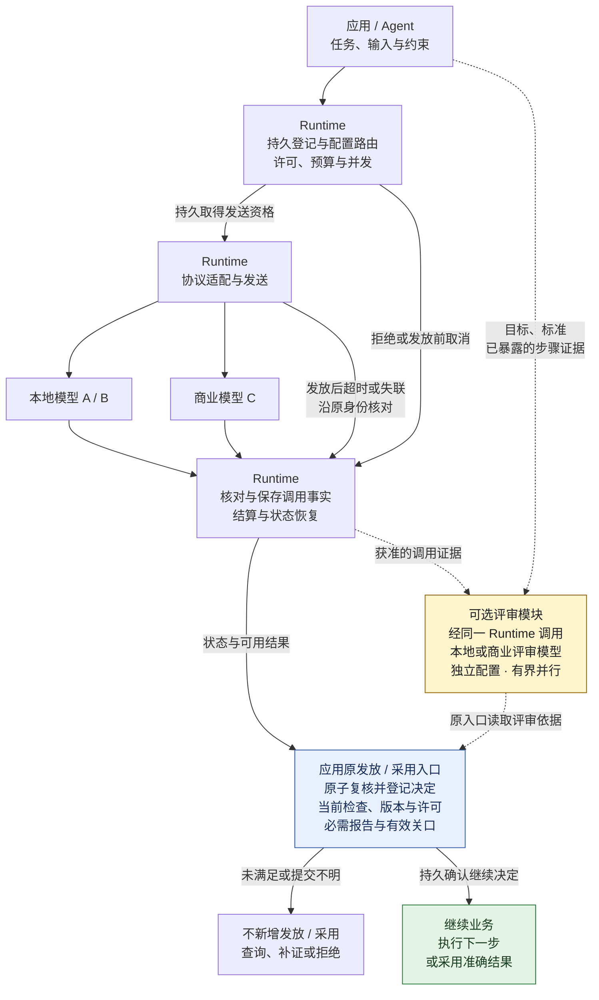
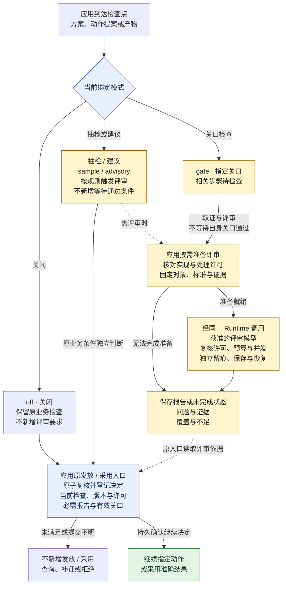

# infra-model-runtime

面向本地与商业大语言模型的通用调用运行组件，计划提供配置切换、按需路由、多模型有界并发、调用状态持久化、预算控制、取消与故障恢复。

它要解决的问题是：**让应用通过统一入口使用不同模型，按实际需要切换或并行调用，并在失败、中断后查清每次调用的状态与结果。**

**当前阶段：R2 串行模型运行包候选（`0.1.0a1` alpha）。** 已实现配置切换、两种协议、原请求持久化、预算、取消和本地恢复，复用 R1 同库事务核心。源码、安装与包外合成验证分别见 [R2 记录](docs/R2_VALIDATION.md)，具体 API 与边界见 [R2 合同](docs/R2_CONTRACT.md)；[响应捕获复核](docs/R2_CAPTURE_REVIEW.md)补齐损坏响应中的转义凭据检查；[进程中断复核](docs/R2_PROCESS_REVIEW.md)补验两协议共 14 个真实强制终止窗口；最新[响应可用性复核](docs/R2_PAYLOAD_REVIEW.md)修正正常未捕获响应的错误分类，源码/实际安装各 135 项通过，旧原请求可准确接续。公共 API 仍为 candidate；多模型并发、真实服务和已有应用接入待验。下文图示描述完整目标。

具体落地方案见[需求与验收范围](docs/REQUIREMENTS.md)、[架构与候选公共边界](docs/ARCHITECTURE.md)和[分阶段实施计划](docs/IMPLEMENTATION_PLAN.md)。先验证公共合同与事务边界，再抽取可独立安装的串行核心、完成首个应用接入，随后扩展按需路由与多模型并发。

新增[调用故障隔离与恢复策略候选](docs/CALL_RECOVERY_POLICY.md)，细化已有 UNKNOWN、执行槽与预算分离的原则，明确本地读回、文本再生成及外部动作的不同责任。当前仍为设计；新的关联调用不能绕过原未知占用或共享限额。

## 它解决什么问题

| 使用者的问题 | 本组件的职责 |
| --- | --- |
| 本地模型与商业模型怎么切换？ | 应用提交统一请求，通过配置选择模型服务及协议适配器，避免业务代码分别处理各家协议 |
| 不同任务能用不同模型吗？ | 按任务需求、模型能力、数据外发许可和预算选择已配置的模型 |
| 多个本地、商业模型能一起工作吗？ | 支持多个任务并行；调用方也可明确要求同一任务调用多个模型，每次调用分别记录和计量 |
| 怎样约束调用数量与并发占用？ | 在发送前检查并预留预算与并发额度，约束参与同一协调范围的调用 |
| 程序重启、超时或响应丢失后怎么办？ | 从持久记录接续，核对原调用；无法确认的状态保留为待确认，避免盲目重复发送 |
| 返回的内容究竟来自哪里？ | 关联原请求、所选服务与模型、配置版本、提供方响应标识、结果、用量及失败记录，供应用取回和判断 |

例如，应用可以将一批摘要任务交给本地模型，将获准外发的复杂分析交给商业模型，两类任务同时推进。需要比较时，调用方可让同一份获准输入分别请求多个模型，再根据各自的完整结果作出判断。

**取得模型响应、结果保存成功、用量完成结算和业务采用是不同事实。** Runtime 核对响应的协议与输出合同；内容是否正确、是否采用以及是否继续执行业务，由应用决定。

## Runtime 是什么意思

`infra-` 表示跨项目复用的基础机制；`model` 表示被调用的模型；`runtime` 表示调用从登记、发送、等待、结算到恢复的运行过程。

本组件管理模型调用的生命周期。模型推理由配置的本地或商业服务完成；模型训练、权重部署和推理引擎建设属于这些服务。首个交付形态计划为可嵌入应用的独立 Python 库，无须先部署一个常驻网络服务。

## 在应用中的位置

下图展示目标架构，以一次结果检查为例；关键动作发放前的关口见后面的[监督流程](#可选模型监督)。执行模型与评审模型分别配置，均可选择本地或商业模型、单个或有上限的多个目标；配置切换作用于后续新调用，旧调用保持原身份与绑定。

实线是基础调用主线，虚线是按需启用的评审交接。只有满足调用方约束并取得发送资格的分支才会发出请求。每次调用独立返回状态，在交付条件满足时提供可用结果；汇合不表示等待所有模型成功。两图展示完整候选设计；当前仅实现上述 R1 原型，完整流程尚未实现；GitHub 窄屏可使用图内缩放、平移控件查看细节。



可选评审支路中的“同一 Runtime”表示复用基础调用合同及同一协调范围内的预算、资源约束，每次评审仍有独立调用身份与账目。原调用的保存、结算与运行观察不等待评审；监督关闭也不关闭这些基础能力。评审只能检查实际交付的证据，不能读取模型隐藏的内部思考。图中报告交接本身不授予执行权，是否等待报告由下图中的模式决定。

图中的超时或失联先回到原调用核对；已经持久确认的事实保持，尚未核清的状态轴保留待确认，不把整个调用统一改写为成功、失败或未知。

这里的“发放”指持久确认本次调用的发送资格及额度预留，不代表请求已到达供应商。发放与取消、撤权须按明确的协调顺序核对：先确认取消或撤权的，阻止发放；已经发放的，按在途调用处理，不能承诺撤回。这个边界也覆盖取得资格后、真正发送前进程退出的窗口。

协议适配器位于 Runtime 与模型服务之间，负责请求与响应的协议转换及校验。应用使用统一的调用与结果结构，但不同模型的能力、质量和返回内容仍可能不同；缺少所需能力时，应在发送前拒绝该目标。接口名称相同或一次简单探测通过，不代表流式输出、工具调用、多模态等能力都可用；这些能力须分别声明和验证。

适配器应关闭 SDK/HTTP 客户端对生成请求的隐式重试和自动重定向；新的生成尝试或目标变化须经过 Runtime 的登记、许可和预算检查。配置的下游服务或代理是否会自行重试，应作为服务能力与限制核对记录；客户端只发送一次不证明下游只执行一次。

配置中选择的模型与提供方报告的模型标识分别留存；响应中的名称和用量属于提供方报告，不自动证明底层实际模型、账户身份或最终费用。

调用状态由 Runtime 持久保存。恢复时先核对原存储与记录：确认尚未发放的调用，可重新检查当前许可后完成首次发放；已经发放的调用，只按原身份对账已捕获响应、接续保存与结算，不因重启而再次生成。原记录丢失、损坏或读取失败时应停下核对，不能当成新请求重新创建。确需查询远端时，仅使用服务明确支持的可靠查询能力；无法确认是否执行的仍保持待确认。库内幂等不能保证供应商端恰好执行一次。

## 配置切换与多模型并行

目标是让应用声明“需要完成什么、允许使用哪些能力与资源”，由配置决定具体服务、模型和适配协议。

| 使用方式 | 行为 |
| --- | --- |
| 默认模型切换 | 默认配置生效后，让后续新调用使用另一个本地或商业模型 |
| 按任务路由 | 不同任务按各自策略选择模型，例如摘要与复杂分析使用不同服务 |
| 多任务并行 | 多个独立任务可同时使用本地与商业模型，受预算和并发上限约束 |
| 同一任务调用多个模型 | 明确拆成关联的多次调用，各自保存结果与用量；结果比较和采用规则由应用提供 |

配置切换作用于后续新登记的调用。已经登记、排队或发送的调用绑定原配置快照，恢复时保持原身份与目标；需要改用其他模型时，创建有明确关联的新调用。

**绑定旧快照不等于保留永久执行许可。** 排队调用在发放前仍须检查当前许可、目标、能力、凭据绑定及剩余额度。原目标被停用、撤权或发生实质变化时应阻止新的发放，不自动改到新模型或新账户。配置的校验与生效须是明确操作；是否支持自动监听文件变化等便利功能，留待配置接口定义。

并发限制需要覆盖整体、单个服务以及共享资源组。例如，两个本地服务共用一张 GPU，或多个商业模型共用同一个账号额度时，应共同受限。预算与资源组绑定稳定身份，不能因配置改名、切换默认模型或进程重启而清零。

共享限额只约束使用同一持久协调存储、资源组定义和准入规则的调用；多个进程必须通过该存储原子竞争额度。各自使用独立数据库的实例不会自动共享预算；跨机器协调需要另行设计和验收。本组件也不能限制绕过它的请求，调用并发上限不等于 GPU 显存或供应商费用的物理硬限制。

同一任务调用多个模型时，每个子调用都有独立身份、预算和状态；某一路失败、取消或待确认，不抹去其他路的结果。是否等待、接受部分结果或取消其他路由应用决定。已发送的调用不能通过撤销整个任务来撤回，取消与结算仍按各调用的事实处理。

模型切换、重试或后续增加的回退策略，都必须重新满足所需能力、外发许可与预算要求。本地服务不可用本身不构成向商业服务发送输入的许可。

“本地”名称、回环地址或兼容某种协议，都不能单独证明数据不会经代理继续外发；许可应绑定实际服务处理范围。

## 调用与恢复的基本约定

以下约定将落实到公共接口和验收用例中：

- **先登记，再发送。** 每次调用具有稳定身份，保存冻结的输入或可核验的准确版本引用、所选服务及配置快照。同一请求身份、相同内容的重复提交应找回原记录，不按新默认配置重新路由；身份相同而内容不同应拒绝。登记回执表示当时的登记事实，当前进度须另行查询，不能以旧回执覆盖后来发生的取消或结算。
- **发放与预留保持一致。** 发送前以原子操作取得该调用唯一的发送资格及所有必需的预算、并发额度；不足时不发放，也不遗留部分预留。排队记录本身不占用执行中的并发槽。发放提交结果不明时先核对原记录，只有确认取得资格的执行者才能发送；重启或租约到期本身不授予第二次发送资格。结算与槽位释放分别按事实幂等接续，不能重复退款或释放其他调用的占用。持久确认远端执行终结后，可释放相应执行并发槽；用量尚未核清的预算预留继续保留。仅有本地超时、取消或租约到期不能作为远端终结依据。
- **业务准入有明确交接。** 应用提供可核对的准入版本及失效规则，通过共享事务或持久交接协议与调用登记、发放衔接。跨存储交接可以存在待确认状态，但在交接确认且业务准入仍有效之前不得发放；入队时检查一次不能替代发放时的核对。短事务和锁外执行网络请求，避免慢调用阻塞其他可准入任务。
- **未知状态不能冒充失败或成功。** 超时、断连或进程退出不证明服务没有执行；不自动重发可能已经执行的请求，也不自动退回尚未核清的预留额度。
- **取消请求与实际停止分别记录。** 本地取消被接受，不代表服务端已经停止生成或计费；后续结果与用量仍需核对。
- **结果与用量独立核对。** 响应完整性、输出合同、持久保存、远端终结和用量各自记录。捕获响应不等于具备交付资格：终结、输出合同及准确保存尚未确认的内容只能作为诊断材料，不标为可用结果。缺失用量不能填零，输出不合格也不能当成没有消耗；迟到响应沿原调用对账，不能撤销已经记录的取消，历史可读也不授予当前业务采用许可。
- **失败记录可接续。** 核清原调用并获准后的新尝试关联原调用，保留原输入、失败和确认过程；不能用后续成功覆盖此前发生的事实。
- **等待与存储均有边界。** 单次调用的期限覆盖排队等待，发放前再次核对；过期的未发放调用不再发送，原身份重放或进程重启不续期。已发放调用的期限届满不证明远端已停止，仍按原身份对账。输入、响应及持久记录均有容量上限；截断或超限内容不能作为完整结果交付。
- **密钥与业务数据有明确边界。** 配置引用受控的凭据来源，运行记录不保存密钥；输入、输出和审计材料的保存位置及访问权限由部署明确配置。

调用预算与持久记录容量分开管理。预算按明确单位分别记录调用次数、输入与输出用量等额度；登记还须满足记录容量限制，并预留必要的控制与对账空间。生成预算不足时阻止新增发放；记录容量不足以容纳新登记及其预留时拒绝新登记，不挪用已有调用的预留。已有记录的读取、取消记录与对账不要求新增生成预算；不得通过重建记录逃避历史占用。待确认调用保留尚未核清的相关占用，其他调用按所属预算和资源组的剩余额度判断，避免无关任务被一并阻塞。

逻辑容量预留不保证物理存储可用。协调存储出现故障时应停止该协调范围的新发放；无法确认写入是否成功时报告待确认，不把内存中的取消或结果当作已保存。恢复后先按原身份核对，再接续原操作。

核对出的用量超过预留时，应完整入账并重算预算余额，不能把账目截断成预留值；相关目标的计量与限额假设须重新核验，核验前暂停向该目标新增发放。其他目标仍按其所属预算和资源组判断：剩余额度不足以覆盖新预留时不得发放，不能因隔离一个目标就停掉所有无关调用。降低上限也不能抹掉既有消耗或在途预留；恢复准入的规则须明确配置并验收。

预算控制约束组件允许发起的调用及其资源预留。服务端的实际计费可能包含无法即时确认的用量，因此本地预算记录不能直接替代服务账单；金额预算还需要明确价格版本、计价口径和供应商对账规则，不能把 token 额度直接宣称为费用硬上限。

## 可选模型监督

计划支持应用按需要接入[可选监督与检查关口](docs/OPTIONAL_SUPERVISION.md)：用已配置的本地或商业模型检查结果、阶段证据或关键动作提案，也可用于尚不熟悉的模型的受监督试用。执行模型与评审模型分别配置，支持后续评审动态切换。

默认关闭；不配置或安装评审模块也可使用基础 Runtime。应用可以在方案形成后、关键动作发放前、阶段产物形成后或最终采用前设置检查点。下图说明一个检查点如何按已绑定策略决定是否继续。先确定模式及是否触发评审，再按需准备评审材料；off 和未触发的抽检不要求新增评审包。关键动作的 gate 必须在该动作发放前满足，事后评审不能追认为事前保护。图中虚线用于按需触发评审或读取评审依据；gate 是否满足仍由原入口按绑定规则判断。



- **关闭**：对尚未绑定监督计划的新任务/检查点，不新增评审调用或依赖。改默认值为 off 不清除旧任务的关口、在途评审或未结费用。
- **抽检 / 建议**：业务采用不新增“等评审通过”的条件；评审仍消耗共享资源，可能影响后续调用的可用额度和等待时间。报告未完成、异常或不确定均如实记录。
- **指定关口**：只约束选定步骤。缺实现、缺证据、预算不足、超时、分歧或评审不可用均不自动通过。模型报告 pass 也不能覆盖失败的必需检查、撤权、取消或对象版本变化。

评审准备与发放仍须符合当前读取和处理许可，但不要求正在评审的那个关口预先通过；取得待评审材料不等于可以业务采用。缺实现、无处理许可或无法准备足够证据时，直接记录未完成状态，不要求先发出评审调用；抽检/建议仍可独立判断原业务条件，gate 不自动通过。

报告连线表示应用原入口读取依据，报告到达本身不触发业务动作。重复通知或迟到报告沿原评审和原决定身份核对，不重复发放动作或采用结果；尚待决定的步骤仍核对当前对象与规则，迟到的 pass 不恢复已取消或过时的资格。告警、暂停或修订等额外动作由应用按显式策略另行决定，评审模块不自行执行。

最终继续决定属于应用，不能把模型意见直接当执行令牌。应用在原动作发放或采用的短事务内，重核准确对象、标准/策略修订、当前权限、取消及必需检查，并持久登记决定；模型网络调用在事务外执行。提交结果不明时，沿原决定查询和接续，不以新身份重复发放动作或重复采用。此能力尚未实现，先验证小场景的实际收益，再增量扩展。

## 与其他组件的关系

以下是职责划分与组合方向。本仓当前尚未完成这些集成；独立使用不要求同时部署表中的其他组件。

| 组件 | 主要职责与本仓关系 |
| --- | --- |
| **infra-model-runtime** | 管理模型选择、协议适配、调用状态、预算、并发、取消与恢复 |
| 应用或 Agent | 组织材料与上下文，定义外发许可和业务准入，处理更正、引用、结果比较与最终采用 |
| [infra-artifact-ledger](https://github.com/kongbu0621/infra-artifact-ledger) | 保存材料和成果的稳定身份、准确版本、内容与来源；可用于模型输入和输出的归档引用，调用状态仍由 Runtime 管理 |
| [infra-local-hand](https://github.com/kongbu0621/infra-local-hand) | 在受控机器上执行获准任务并返回状态与证据；模型调用可由独立应用使用 Runtime，也可处于获准任务内部 |
| [control-production-plane（P）](https://github.com/kongbu0621/control-production-plane) | 协调目标、计划、执行、验证和接续；后续可按需要使用模型能力，任务推进和验收决定仍归 P |
| [domain-operational-knowledge-core（K）](https://github.com/kongbu0621/domain-operational-knowledge-core) | 管理知识候选、审查、版本、采用与反馈；模型可辅助生成候选，知识准入仍须遵循 K 的审查规则 |

组件通过公共接口组合，各自保存其负责的状态和事实。Runtime 的调用完成、Ledger 的材料保存以及应用的业务验收，是需要分别核对的结果。

## 首版建设与验收

首版从已有应用中的调用机制提取通用部分，复用适用实现与回归用例。业务材料、上下文规则、更正与引用等逻辑保留在应用中；已有应用的验证结果不直接等同于独立组件通过验收。

| 建设项 | 目标与验收重点 | 当前状态 |
| --- | --- | --- |
| 公共接口与配置 | 定义请求、结果、错误、配置快照、凭据引用和能力检查；验证新调用切换、旧调用保持身份及撤权/取消与发放的先后关系 | R2 已实现候选配置、凭据引用与显式能力批准；稳定 API 待验 |
| 协议适配 | 首批计划覆盖 Responses 与 Chat Completions 两类协议；逐项验证目标服务能力，并检查底层重试与重定向不会绕过调用登记和准入 | R2 已实现两协议的有限非流式 JSON 模式；真实服务待验 |
| 持久调用与预算 | 验证登记与当前状态分离、发放前后中断、记录容量不足、存储故障、迟到响应、缺失用量及实际超额；并发槽与预算分别处理，发送和结算不因重启重复 | R2 单槽/单池、内置有界捕获和所列恢复检查通过；完整故障矩阵待验 |
| 多模型有界并发 | 验证同一协调范围内的多进程额度竞争、共享资源限制、排队过期、部分失败与无关任务接续；每次调用独立留痕 | 待实现 |
| 独立打包与应用接入 | 独立安装后，由最小示例及原应用通过公共接口调用，保持既有业务约束与持久交接规则 | R2 已有独立包及包外合成示例；原应用接入/迁移留 R3 |
| 实际服务验证 | 分别验证所配置的本地与商业服务，再验证组合调用；模拟服务通过不替代实机结论 | 待建设与验收 |

推进顺序为：确定公共接口、配置与事务合同，抽取并独立安装串行核心及协议适配，由首个应用验证接入，再扩展按需路由、多模型并发与恢复，最后完成所声明范围的真实服务验收。各阶段的退出条件见[实施计划](docs/IMPLEMENTATION_PLAN.md)，保留准确版本、运行环境及未覆盖项。

当前可从审阅源码构建 wheel，在本项目已有独立虚拟环境中安装；不要将候选包直接装进现有业务环境。构建工具和准确验收版本见 [R2 验证](docs/R2_VALIDATION.md)。

```bash
python -m pip wheel --no-deps --wheel-dir dist .
python -m pip install --no-deps dist/infra_model_runtime-0.1.0a1-py3-none-any.whl
python examples/serial_consumer.py
```

示例只使用合成本机回环服务，依次切换两协议，并核对重开后的原回执、结果及实际发送次数；不消耗商业模型额度。尚未上传 PyPI 或创建软件 Release；仓库许可证仍未选定，不把 public 可见性当作开源许可。

